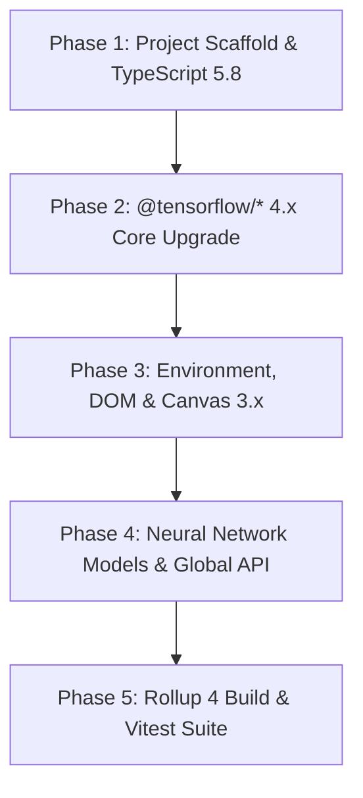

# Migration Overview: `face-api.js` to `ts-face-api`

## 1. Objective & Scope

This migration plan defines a phased, zero-disruption path to create a modernized TypeScript project named **`ts-face-api`** in a sibling directory (`../ts-face-api`), managed via **`pnpm`**, while preserving the existing `face-api.js` repository (`./`) completely untouched.

### Core Requirements
- **Project Name**: `ts-face-api`
- **Target Location**: `../ts-face-api` (sibling directory to `face-api.js`)
- **Legacy Preservation**: Keep current `face-api.js` project (`C:\Users\Anakin\Other\face-api.js`) unmodified.
- **Package Manager**: `pnpm` (latest stable, with strict lockfile and workspace compatibility)
- **Core Dependencies (Latest Stable)**:
  - `@tensorflow/tfjs-core`: `^4.22.0`
  - `@tensorflow/tfjs-backend-cpu`: `^4.22.0`
  - `@tensorflow/tfjs-backend-webgl`: `^4.22.0`
  - `@tensorflow/tfjs-node`: `^4.22.0`
  - `canvas`: `^3.1.0` (with fallback notes for `^2.11.2` if prebuilt native binaries are required on older CI images)
  - `typescript`: `^5.8.2`
- **Build & Test Toolchain**:
  - **Bundler**: Rollup 4 (`rollup@^4.x` + `@rollup/plugin-*`)
  - **Test Runner**: Vitest (`vitest@^3.x` + `@vitest/browser` + `playwright`)

---

## 2. Directory Topology

```text
C:\Users\Anakin\Other\
├── face-api.js\                      # Existing repository (UNTOUCHED)
│   ├── src\                          # Original TypeScript source (TS 3.8 / TFJS 1.7)
│   ├── test\                         # Original Jasmine + Karma test suite
│   ├── weights\                      # Quantized model weight manifests & shards
│   ├── weights_uncompressed\         # Uncompressed Float32 weights for tests
│   ├── weights_unused\               # Unused TinyYolov2 weights for tests
│   ├── migrations\                   # Migration plan documentation (this folder)
│   │   ├── 00-overview.md
│   │   ├── 01-phase1-scaffold-and-typescript.md
│   │   ├── 02-phase2-tensorflow-core-upgrade.md
│   │   ├── 03-phase3-env-dom-and-canvas.md
│   │   ├── 04-phase4-models-and-global-api.md
│   │   └── 05-phase5-build-test-and-validation.md
│   └── package.json
│
└── ts-face-api\                      # New sibling project (pnpm + TS 5.8 + TFJS 4.22)
    ├── src\                          # Migrated TypeScript source
    ├── test\                         # Migrated Vitest test suite (Node + Browser)
    ├── weights\                      # Copied model weights
    ├── weights_uncompressed\         # Copied test weights
    ├── weights_unused\               # Copied test weights
    ├── dist\                         # UMD/ESM browser bundles (ts-face-api.js, ts-face-api.min.js)
    ├── build\                        # Compiled ESM (build/es6) & CJS (build/commonjs) + .d.ts
    ├── package.json                  # name: "ts-face-api", packageManager: "pnpm@10.x"
    ├── pnpm-lock.yaml
    ├── tsconfig.json                 # Base TypeScript 5.8 config (CJS / typecheck)
    ├── tsconfig.es6.json             # ESM build config
    ├── rollup.config.mjs             # Rollup 4 configuration
    └── vitest.config.ts              # Vitest Node & Browser test configuration
```

---

## 3. Dependency Upgrade Matrix

| Category | Package | Legacy (`face-api.js`) | Target (`ts-face-api`) | Migration Action |
| :--- | :--- | :--- | :--- | :--- |
| **Package Manager** | `npm` -> `pnpm` | `npm` (`package-lock.json`) | `pnpm` (`^10.x`, `pnpm-lock.yaml`) | Initialize with `pnpm init`, configure `.npmrc` |
| **TensorFlow Core** | `@tensorflow/tfjs-core` | `1.7.0` | `^4.22.0` | Upgrade API calls, tensor generics, weight loaders |
| **TF CPU Backend** | `@tensorflow/tfjs-backend-cpu` | *(bundled in core 1.x)* | `^4.22.0` | Explicit dependency & registration in `src/index.ts` |
| **TF WebGL Backend**| `@tensorflow/tfjs-backend-webgl`| *(bundled in core 1.x)* | `^4.22.0` | Explicit dependency & registration in `src/index.ts` |
| **TF Node Backend** | `@tensorflow/tfjs-node` | `1.7.0` | `^4.22.0` | Upgrade dev/peer dependency for Node inference |
| **Node Canvas** | `canvas` | `2.6.1` | `^3.1.0` | Upgrade dev/peer dependency, update `env` types |
| **Compiler** | `typescript` | `3.8.3` | `^5.8.2` | Remove `suppressImplicitAnyIndexErrors`, fix strict types |
| **Runtime Helpers** | `tslib` | `^1.11.1` | `^2.8.1` | Upgrade helper runtime |
| **Node Types** | `@types/node` | `^13.9.2` | `^22.13.0` | Align with modern LTS Node.js (`fetch`, `Buffer`) |
| **Bundler** | `rollup` | `^2.1.0` | `^4.34.0` | Migrate `rollup.config.js` to `rollup.config.mjs` |
| **Rollup Plugins** | `rollup-plugin-*` | `commonjs@10`, `node-resolve@5`, `typescript2@0.26`, `uglify@6` | `@rollup/plugin-commonjs@^28`, `@rollup/plugin-node-resolve@^16`, `@rollup/plugin-typescript@^12`, `@rollup/plugin-terser@^0.4` | Replace deprecated plugins (`uglify` only supported ES5) |
| **Test Framework** | `jasmine` + `karma` | `jasmine@3.5`, `karma@4.4`, `karma-typescript@5.0`, `ts-node@8.7` | `vitest@^3.0.0`, `@vitest/browser@^3.0.0`, `playwright@^1.50.0` | Replace Jasmine/Karma with Vitest (Node + Headless Chromium) |
| **Docs Generator** | `typedoc` | *(unpinned CLI)* | `^0.27.0` | Update `typedoc.config.mjs` to modern TypeDoc options |

---

## 4. Phased Migration Roadmap



### Phase Breakdown

1. **[Phase 1: Scaffold & TypeScript 5.8](./01-phase1-scaffold-and-typescript.md)**
   - Create `../ts-face-api`, copy `src/`, `test/`, `weights*`, initialize `pnpm`, install packages, modernize `tsconfig.json`, and eliminate TS 5.0+ breaking compiler flags (`suppressImplicitAnyIndexErrors`) and implicit `any` index accesses.
2. **[Phase 2: TensorFlow.js 4.x Core Upgrade](./02-phase2-tensorflow-core-upgrade.md)**
   - Register modular TFJS 4.x backends (`@tensorflow/tfjs-backend-cpu`, `@tensorflow/tfjs-backend-webgl`), fix pooled Node `Buffer.buffer` slicing bug in `NeuralNetwork.loadFromDisk`, and update tensor operations (`tf.batchNorm`, `tf.avgPool`, `tf.maxPool`, `tf.pad`, `tf.slice3d`, `arraySync()`) to satisfy TFJS 4.x types.
3. **[Phase 3: Environment, DOM & Canvas Upgrade](./03-phase3-env-dom-and-canvas.md)**
   - Upgrade `src/env/` and `src/dom/` for Node 18+ native `fetch`, `canvas@^3.1.0` (`createCanvasElement` dimensions handling, `Image`, `ImageData`), and `tf.browser.fromPixels` / `tf.browser.toPixels` compatibility.
4. **[Phase 4: Neural Network Models & Global API](./04-phase4-models-and-global-api.md)**
   - Audit and verify all 7 model families (`SsdMobilenetv1`, `TinyFaceDetector`, `TinyYolov2`, `Mtcnn`, `FaceLandmark68Net`, `FaceRecognitionNet`, `FaceExpressionNet`, `AgeGenderNet`) and `globalApi` composable tasks.
5. **[Phase 5: Build Pipeline (Rollup 4) & Testing (Vitest)](./05-phase5-build-test-and-validation.md)**
   - Configure `rollup.config.mjs`, dual CJS/ESM `package.json` exports, and migrate Node and Browser tests from Jasmine/Karma to Vitest (`vitest.config.ts`), including updating WebGL backend test helpers in `test/utils.ts`.

---

## 5. Phase Completion Gates

| Phase | Gate Command in `../ts-face-api` | Expected Outcome |
| :--- | :--- | :--- |
| **Phase 1** | `pnpm install` | Clean dependency tree and `pnpm-lock.yaml` generated |
| **Phase 2** | `pnpm tsc --noEmit` (on `src/ops`, `src/common`, `src/NeuralNetwork.ts`) | Core TFJS tensor ops and base network compile cleanly |
| **Phase 3** | `pnpm tsc --noEmit` (on `src/env`, `src/dom`) | Environment and `canvas` bindings compile with zero errors |
| **Phase 4** | `pnpm typecheck` (`tsc --noEmit` across entire `src/`) | Full source tree compiles under TypeScript 5.8 |
| **Phase 5** | `pnpm build && pnpm test:node && pnpm test:browser` | `dist/` + `build/` artifacts emitted; all unit & integration tests pass |
