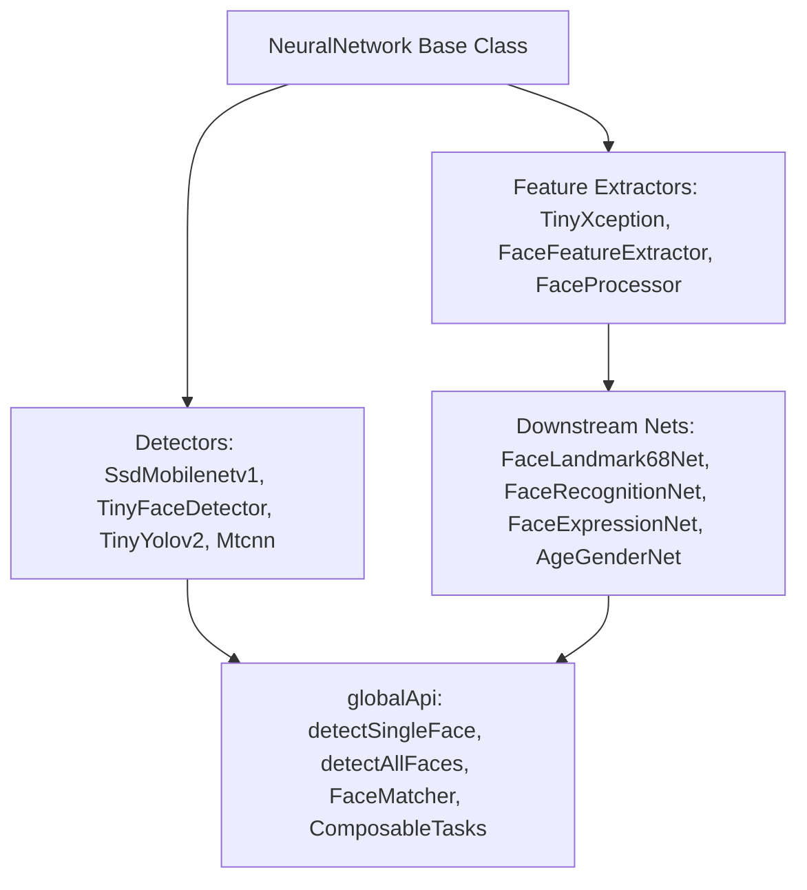

# Phase 4: Neural Network Models, Weight Loaders & Global API

## Objective

Verify and update all neural network architectures, parameter extractors, drawing utilities, and the high-level composable `globalApi` in `../ts-face-api/src/` so they compile cleanly with TypeScript 5.8 and execute inference accurately under `@tensorflow/tfjs-core@^4.22.0`.

---

## Step 4.1: Module-by-Module Audit & Required Adjustments



### 1. Common Parameter Extractors (`src/common/`)
Files:
- `[src/common/disposeUnusedWeightTensors.ts](../src/common/disposeUnusedWeightTensors.ts)`
- `[src/common/extractConvParamsFactory.ts](../src/common/extractConvParamsFactory.ts)`
- `[src/common/extractFCParamsFactory.ts](../src/common/extractFCParamsFactory.ts)`
- `[src/common/extractSeparableConvParamsFactory.ts](../src/common/extractSeparableConvParamsFactory.ts)`
- `[src/common/extractWeightEntryFactory.ts](../src/common/extractWeightEntryFactory.ts)`
- `[src/common/extractWeightsFactory.ts](../src/common/extractWeightsFactory.ts)`

**Audit Notes**:
- `extractWeightEntryFactory.ts` indexes `weightMap[paramPath]`. Because `tf.NamedTensorMap` is typed as `{ [name: string]: tf.Tensor }`, indexing by `string` is valid in TS 5.8.
- In `[src/common/disposeUnusedWeightTensors.ts](../src/common/disposeUnusedWeightTensors.ts)`, type `weightMap: tf.NamedTensorMap` explicitly instead of `any`.

### 2. Face Detectors
- **SSD MobileNet V1 (`src/ssdMobilenetv1/`)**:
  - `[src/ssdMobilenetv1/SsdMobilenetv1.ts](../src/ssdMobilenetv1/SsdMobilenetv1.ts)`: Ensure `boxes.arraySync() as number[][]` (covered in Phase 2).
  - `[src/ssdMobilenetv1/outputLayer.ts](../src/ssdMobilenetv1/outputLayer.ts)`: Verify `tf.unstack` and `tf.stack` return types in `getCenterCoordinatesAndSizesLayer` and `decodeBoxesLayer`.
- **TinyYolov2 & TinyFaceDetector (`src/tinyYolov2/`, `src/tinyFaceDetector/`)**:
  - `[src/tinyYolov2/TinyYolov2Base.ts](../src/tinyYolov2/TinyYolov2Base.ts)` (line 124):
    ```typescript
    const out0 = tf.tidy(() => tf.unstack(out)[0].expandDims()) as tf.Tensor4D
    ```
    Ensure `scoresTensor.array()` and `boxesTensor.array()` are cast to `number[][][][]` (covered in Phase 2).
- **MTCNN (`src/mtcnn/`)**:
  - `[src/mtcnn/stage1.ts](../src/mtcnn/stage1.ts)`, `[src/mtcnn/stage2.ts](../src/mtcnn/stage2.ts)`, `[src/mtcnn/stage3.ts](../src/mtcnn/stage3.ts)`:
    In `stage2.ts` and `stage3.ts` (line 33), `tf.concat(rnetOuts.map(out => out.scores))` concatenates `Tensor1D[]` into `Tensor1D`. Verify no rank mismatch under TFJS 4.x.
  - `[src/mtcnn/extractImagePatches.ts](../src/mtcnn/extractImagePatches.ts)` (lines 48-52):
    ```typescript
    const t = tf.tidy(() => {
      const imagePatchTensor = tf.transpose(
        tf.tensor4d(data, [1, width, height, 3]),
        [0, 2, 1, 3]
      ).toFloat() as tf.Tensor4D
      return normalize(imagePatchTensor)
    })
    ```
    In `extractImagePatches.ts` line 32, `imageData = Array.from(ctx.getImageData(0, 0, width, height).data)` converts `Uint8ClampedArray` to `number[]`, which `bitShift` converts to a 3-channel RGB `number[]` (`data`). This remains compatible with `tf.tensor4d(data, [1, width, height, 3])`.

### 3. Landmark, Recognition, Expression & Age/Gender Networks
- **FaceLandmark68Net (`src/faceLandmarkNet/`)**:
  - `[src/faceLandmarkNet/FaceLandmark68NetBase.ts](../src/faceLandmarkNet/FaceLandmark68NetBase.ts)` (lines 41-56):
    Verify chained `.mul(...)`, `.sub(...)`, `.div(...)` calls on `output` (`tf.Tensor2D`) retain or cast to `tf.Tensor2D` on line 56 (`return landmarkTensors as tf.Tensor2D`).
- **FaceRecognitionNet (`src/faceRecognitionNet/`)**:
  - `[src/faceRecognitionNet/residualLayer.ts](../src/faceRecognitionNet/residualLayer.ts)` (lines 18-35):
    `tf.avgPool(x, 2, 2, 'valid')` and `tf.zeros<tf.Rank.R4>(pooled.shape)` use `pooled.shape` (`[number, number, number, number]`). Verify `padShapeX` and `padShapeY` are typed as `[number, number, number, number]` so `tf.zeros<tf.Rank.R4>(padShapeX)` satisfies TFJS 4.x `ShapeMap[R]`:
    ```typescript
    const padShapeX: [number, number, number, number] = [out.shape[0], pooled.shape[1] - out.shape[1], out.shape[2], out.shape[3]]
    ```
    and
    ```typescript
    const padShapeY: [number, number, number, number] = [out.shape[0], out.shape[1], pooled.shape[2] - out.shape[2], out.shape[3]]
    ```
- **FaceExpressionNet (`src/faceExpressionNet/`)**:
  - `[src/faceExpressionNet/FaceExpressions.ts](../src/faceExpressionNet/FaceExpressions.ts)` (lines 27-29):
    ```typescript
    FACE_EXPRESSION_LABELS.forEach((expression, idx) => {
      this[expression] = probabilities[idx]
    })
    ```
    Ensure `expression` is typed as `FaceExpression` (`typeof FACE_EXPRESSION_LABELS[number]`) or cast `(this as any)[expression] = probabilities[idx]` so TS 5.8 does not raise `TS7053`.
- **AgeGenderNet (`src/ageGenderNet/`)**:
  - `[src/ageGenderNet/AgeGenderNet.ts](../src/ageGenderNet/AgeGenderNet.ts)`: Verify `tf.unstack(out.age)` and `tf.unstack(out.gender)` tensor disposal in `predictAgeAndGender`.

### 4. Global API & Factories (`src/globalApi/`, `src/factories/`)
- `[src/globalApi/ComposableTask.ts](../src/globalApi/ComposableTask.ts)`:
  `ComposableTask<T>` implements custom `then` chains (`public async then(...)`). In TypeScript 5.8, classes with a `then` method are treated as `PromiseLike<T>`. Verify `ComposableTask.run()` and `then()` signatures compile cleanly with `strictNullChecks`.
- `[src/globalApi/FaceMatcher.ts](../src/globalApi/FaceMatcher.ts)`:
  Verify `LabeledFaceDescriptors.fromJSON` and `toJSON` handle `Float32Array` serialization cleanly.

---

## Step 4.2: Model Weight Assets in `../ts-face-api`

Confirm all three weight directories are copied intact from `face-api.js` into `../ts-face-api`:
- `../ts-face-api/weights/` (production quantized weights + `*-weights_manifest.json` files)
- `../ts-face-api/weights_uncompressed/` (`*.weights` binary Float32 files used in unit tests)
- `../ts-face-api/weights_unused/` (`tiny_yolov2` weights used in unit tests)

No re-training or weight format conversion is needed because `tf.io.loadWeights` and `tf.io.weightsLoaderFactory` in `@tensorflow/tfjs-core@^4.22.0` maintain full backward compatibility with TensorFlow.js `weights_manifest.json` v1 quantization (`uint8` scale/min Affine quantization).

---

## Phase 4 Verification Checklist

- [ ] `src/faceRecognitionNet/residualLayer.ts` uses 4-tuple `[number, number, number, number]` for `padShapeX` and `padShapeY`.
- [ ] `src/faceExpressionNet/FaceExpressions.ts` compiles without `TS7053` implicit `any` index errors.
- [ ] Running `pnpm typecheck` (`tsc --noEmit`) in `../ts-face-api` passes with 0 errors across the entire `src/` directory.
